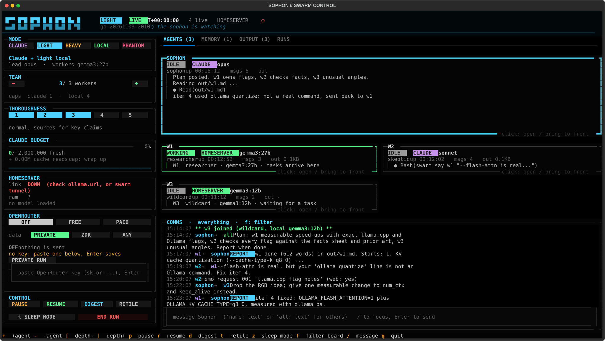
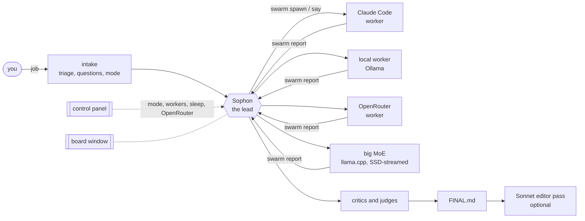

# Sophon

**A lead agent that runs a team of AI agents in your terminal: Claude Code sessions, local models on Ollama, 80B to
120B mixture-of-experts models streamed from an SSD on a 16 GB machine, and optional OpenRouter models. One command
starts a job, one control panel steers it, and every agent works in its own window you can watch.**

```
swarm go
```

You describe a job. Sophon triages it, asks the few questions that matter, picks a mode, spawns workers, makes
them critique each other, and writes `FINAL.md`: a ranked answer with the evidence, the cut ideas and what still
needs you.



## Why

- **Watchable.** Each agent is a real terminal (tmux plus kitty), not a log line. You can read, interrupt or type
  into any of them, and a board window shows every message between agents.
- **Local-first.** The `local` and `phantom` modes use no Claude at all until one optional Sonnet editor pass at the
  end (about 11K tokens in tests).
- **Big models on small machines.** `phantom` mode serves gpt-oss 120B or Qwen3-Next 80B with llama.cpp under a
  systemd memory cap, so the weights stream from the SSD and the machine never swaps. See
  [docs/big-models-low-ram.md](docs/big-models-low-ram.md).
- **Safety rails in code, not in prompts.** Bash file writes are blocked by a hook, spending has hard caps,
  OpenRouter only sees providers that do not train on prompts, and anything irreversible waits for you.

## How it works



Agents talk only through the `swarm` command (`say`, `report`, `peek`, `ask`), so every message lands on the board
and in the run folder. The local pipeline is driven by code, not by a small model's judgement: angles, ideas,
embedding de-duplication, critics with an anchored rubric, a calibrated ranking and fact checks against a facts
sheet of real flags and APIs. Details: [docs/architecture.md](docs/architecture.md).

## Modes

| Mode | Lead | Workers | Claude use | Use it for |
|---|---|---|---|---|
| `light` | Claude (Opus) | local strong model | 140K to 180K tokens | quick daytime jobs |
| `heavy` | Claude (Sonnet), checks in every 30 min | local, up to 10 | 175K to 200K | best quality, overnight |
| `claude` | Claude | Claude (Sonnet), 3 max | 200K to 245K | short, accuracy-critical jobs |
| `local` | code pipeline on a local model | local | about 11K (editor only) | free drafts, private work |
| `phantom` | code pipeline | 80B / 120B MoE from the SSD | about 11K (editor only) | overnight, zero cloud |

`swarm go --sleep` runs unattended: questions of type preference, scope, priority, format or clarify are answered
from your profile; anything about money, deleting, sending or other folders is refused and listed in
`out/needs-you.md`. OpenRouter (off / free / paid, with run and day caps) can add workers from other model families
in any mode.

## Measured results

Self-graded out of 10 by the developer, n = 1 to 3 per cell, two idea-generation jobs. Not a benchmark, a sanity
check:

| Mode | Score | Time | Fresh Claude tokens |
|---|---|---|---|
| heavy | 8.5 | 11 to 34 min | 175K to 199K |
| light | 8 to 8.5 | 3 to 4 min | 143K to 178K |
| claude | 7 | 3 to 11 min | 201K to 245K |
| phantom | 5.5 | 2 h 33 min | 0 |
| local (no editor) | median 3 over 9 runs | 26 to 51 min | 0 |

The lead decides quality: a Claude lead edits, de-duplicates and catches invented facts, while local models of
every size produce mediocre raw ideas. The `local` mode therefore ends with one Sonnet editor pass by default
(`swarm editor off` disables it). The big streamed models made the local critics honest rather than the ideas
better.

Big-model speed, llama.cpp CPU build on an 8-core Zen 4 mini PC with DDR5 and a PCIe 4 NVMe SSD:

| Model (file) | RAM cap 8 GB | 16 GB | 20 GB | Prompt reading |
|---|---|---|---|---|
| gpt-oss 120B MXFP4 (63.4 GB) | 2.5 tok/s | 4.1 tok/s | | about 17 tok/s |
| Qwen3-Next 80B-A3B IQ4_XS (42.6 GB) | 3.8 tok/s | 5.5 tok/s | 7.5 tok/s | 36 to 64 tok/s |

## Quick start

Requirements: Linux with an X11 (or XWayland) desktop, Python 3.11+, `tmux`, `kitty`, `wmctrl`, `xrandr`.
[Ollama](https://ollama.com) for local models, [Claude Code](https://docs.claude.com/en/docs/claude-code) for the
Claude modes (optional in `local` and `phantom`).

```bash
git clone https://github.com/023b/sophon && cd sophon
python3 -m venv .venv && .venv/bin/pip install -e '.[panel]'
sudo apt install tmux kitty wmctrl x11-xserver-utils     # Debian / Ubuntu

.venv/bin/swarm init        # config.toml, profile.md, folders
ollama pull gemma3:4b && ollama pull gemma3:27b && ollama pull nomic-embed-text
.venv/bin/swarm doctor      # checks everything and prints the fix for anything missing
.venv/bin/swarm go          # first run
```

Ollama on another machine (a home server or a desktop with a GPU)? Set `ollama.ssh_host` to an `~/.ssh/config`
alias and Sophon opens the SSH tunnel itself; nothing is exposed on the network.

### 120B on a low-RAM machine

```bash
scripts/setup-big-model.sh gpt-oss-120b         # builds llama.cpp, asks before the 63 GB download
# add the printed [big] block to ~/.config/sophon/config.toml, then
swarm doctor && swarm go --mode phantom
```

Pick the cap from your RAM: 8G on a 16 GB machine, 12G to 16G on 24 to 32 GB, more is faster. A GPU helps even
with little VRAM: add `"-ngl", "99", "--cpu-moe"` to `extra_args` to keep the attention layers on the GPU and the
experts on the CPU. Full guide: [docs/big-models-low-ram.md](docs/big-models-low-ram.md).

## Where things live

Nothing is written inside the source tree. Sophon follows the XDG base directory spec (`swarm paths` prints yours):

| What | Where |
|---|---|
| config.toml, OpenRouter key (mode 600) and settings | `~/.config/sophon/` |
| runs (one folder each), `current` link, profile.md, your personas and facts | `~/.local/share/sophon/` |
| OpenRouter spend ledger and model health, big-model lock | `~/.local/state/sophon/` |
| OpenRouter model catalogue | `~/.cache/sophon/` |

`SOPHON_HOME=/path` puts all four under one folder. Your files in `~/.local/share/sophon/personas/` and `facts/`
override the packaged ones of the same name. More: [docs/file-locations.md](docs/file-locations.md).

## Repository layout

```
swarm                    runs the CLI from a checkout (pip install gives the same `swarm` command)
sophon/
  settings.py            file locations (XDG) and config.toml loading with defaults
  config.py              modes, models, tool allowlists, worker rules derived from settings
  cli.py                 command dispatch and usage text
  setup.py               swarm init, doctor, paths, personas
  intake.py              triage, clarifying questions, mode choice, answers while you sleep
  agents.py              spawn, messages, reports, memory requests, runs
  hooks.py               Claude Code hooks: agents report prompts, turns and state themselves
  term.py                kitty windows and tmux sessions
  backends.py            Ollama, big llama.cpp models under a memory cap, Claude JSON calls, SSH tunnels
  openrouter.py          OpenRouter: modes, data policy, health checks, spending ledger
  worker.py              local worker loop
  pipeline.py            local lead: requirements, angles, ideas, critics, judge
  quality.py             requirement schema, fact and flag checks, embeddings, de-duplication
  final.py               FINAL.md: calibrated ranking, caps, de-duplication
  editor.py              Sonnet editor pass over the local FINAL
  budget.py              Claude usage from transcripts, de-duplicated by message id
  panel.py               the Textual control panel
  data/                  personas, facts sheets, templates, example config and profile
scripts/                 setup-big-model.sh
docs/                    architecture, big models, configuration, file locations, safety
bench/                   blind-comparison and metrics helpers
tests/                   model-free tests (pytest)
```

## Commands

```
swarm go [--mode M] [--sleep] [--job "..."]   start a job (intake, lead, board, panel)
swarm panel                                   control panel for the current run
swarm mode [light|heavy|local|claude|phantom] show or change the mode mid-run
swarm say NAME|all MESSAGE                    talk to agents (as the human)
swarm list | peek NAME | kill NAME | end      watch and stop agents
swarm or status|mode|policy|key|cap|models    OpenRouter
swarm editor on|off | private on|off          Sonnet editor pass, block OpenRouter for a run
swarm init | doctor | paths | personas        setup and checks
```

`swarm --help` lists everything.

## Safety

- Claude Code agents get a per-run hooks file: Bash cannot write files (only Write and Edit, which you can see),
  and permission prompts are reported to the board instead of silently blocking.
- Only the lead can write to long-term memory (an optional MCP server); workers ask with `swarm memo-request`, and
  requests from web-reading workers wait for you while you sleep.
- OpenRouter is off by default. When on, requests go only to providers that do not store or train on prompts
  (`data_collection: deny`), your profile is cut to its judging rules before it leaves the machine, and paid calls
  reserve their worst-case cost against a run cap and a day cap under a lock.
- Big models listen on 127.0.0.1 only and run inside a systemd unit with `MemoryMax` and `MemorySwapMax=0`.

Details: [docs/safety.md](docs/safety.md).

## Status

Working, but developed and tested on one setup; expect rough edges elsewhere. The window layout assumes X11 (or XWayland)
and one or two screens. Contributions and bug reports are welcome.

## Licence

MIT. See [LICENSE](LICENSE).
