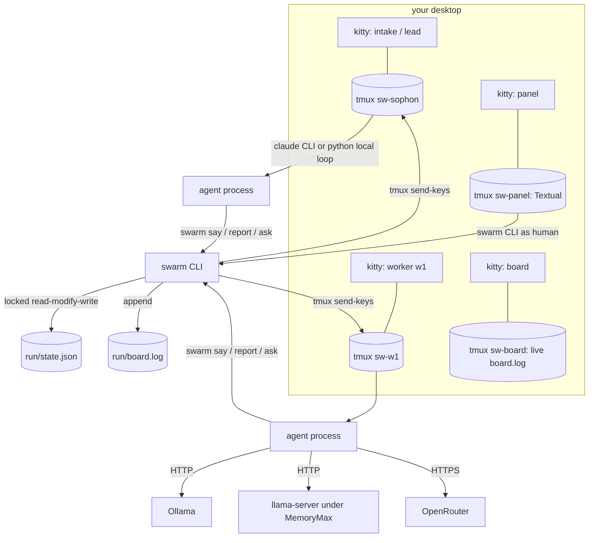

# Architecture

## Processes



Every agent is a process in its own tmux session, displayed in its own kitty window. Claude agents are the
`claude` CLI with a per-run system prompt, tool allowlist and hooks file. Local agents are a small Python loop
(`swarm lw`) that waits for tasks typed into its terminal, streams the answer live and appends it to `out/NAME.md`.

Messages are typed into the receiving terminal with `tmux send-keys` and logged to `board.log`; if the receiver has
a permission dialog open, the message is queued in `inbox/` and prepended to the next one. All shared state is `state.json`, changed only inside `with state(run) as st:`, which holds
an `fcntl` lock for the read-modify-write, so the CLI, the panel and every worker can update it at once without
losing writes.

## Package

The modules form an acyclic chain; each imports only from the ones above it:

```
settings   file locations (XDG), config.toml with defaults
config     constants derived from settings: modes, models, tools, colours, worker rules
util       shell helpers, locked run state, board log, status files
term       monitors, kitty windows, tmux sessions, typing into terminals
hooks      Claude Code hook entry point (`swarm hook EVENT`)
backends   Ollama, llama-server lifecycle, OpenRouter dispatch, Claude JSON calls, SSH tunnels
budget     Claude usage from Claude Code transcripts, de-duplicated by message id
agents     spawn, say, report, memory requests, mode changes, run start and end
worker     local worker loop and context gathering
intake     triage, questioners, mode decision, the brief, answering while you sleep
quality    requirement schema, facts and flag checks, embeddings, de-duplication, rubric anchors
final      FINAL.md assembly: calibrated ranking, family caps, cut and killed lists
editor     Sonnet editor pass over the local FINAL.md
pipeline   the local lead (fixed phases driven by code)
cli        argument dispatch
setup      init, doctor, paths, personas
panel      Textual control panel (imports everything through sophon.api)
```

## The local pipeline

When the lead is local (`local` and `phantom` modes) a model does not decide what happens next; `pipeline.py` does:

1. **Requirements.** One JSON-schema call extracts count, item kind, ordering, exclusions, format (demo, academic,
   practical, general) and audience. Code enforces them from here on.
2. **Angles.** The job is split into twice as many angles as workers, each with a persona and an angle that must
   differ from every other on at least two axes. Each worker owns some angles and is told the others are banned.
3. **Ideas.** Workers write ideas at temperature 1.0 with a random seed and a random constraint card. For open idea
   jobs, a collision generator pairs one of your assets with a mechanism from outside AI per slot.
4. **Fact gate.** Every flag, command, endpoint and number is checked against the facts sheet and the real `--help`
   output of llama.cpp and Ollama; invented ones are marked.
5. **De-duplication.** Ideas are embedded and merged above a cosine threshold, then a maximal-marginal-relevance
   pass keeps a diverse set.
6. **Critics.** Two critics score every idea against anchored examples and must quote the sentence that justifies
   each score; unjustified scores are capped.
7. **Judge and ranking.** Scores are z-normalised per critic, the bottom 30 % is cut, family caps apply, and the
   ranking table is built in code, so a writer model cannot reorder it.
8. **Final and editor.** A local model writes the cards in the fixed order; then one Sonnet call sees only the top
   cards, the hard requirements, the facts sheet and your judging rules, and returns keep, rewrite or drop per card
   plus at most two new cards. Code applies the decisions and keeps the local version as `FINAL-local.md`.

## Claude usage accounting

Claude Code writes one transcript line per content block, so a message with text and two tool calls appears three
times with the same usage. `budget.py` reads the transcripts of every session whose working directory is the run
folder (subagents included), keeps one usage per message id, and reports fresh tokens (input + output + cache
write) separately from cache reads. At the budget the mode drops to heavy and the lead is told to wrap up.
